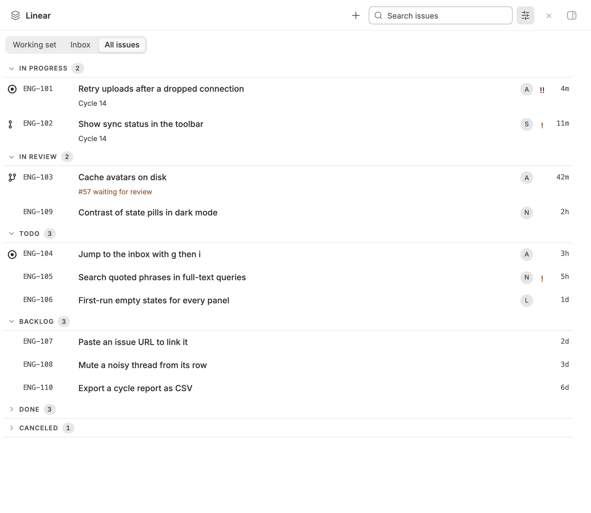
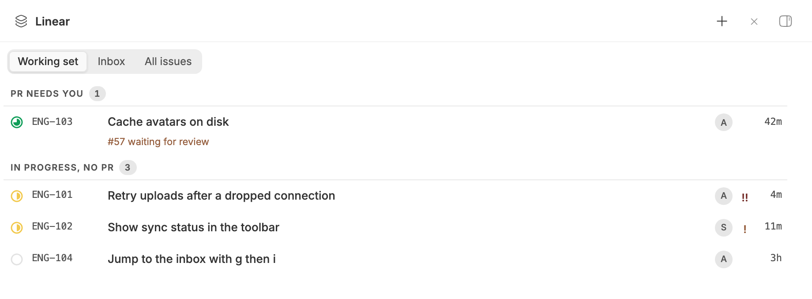
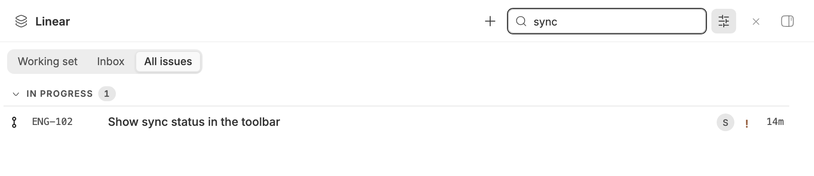
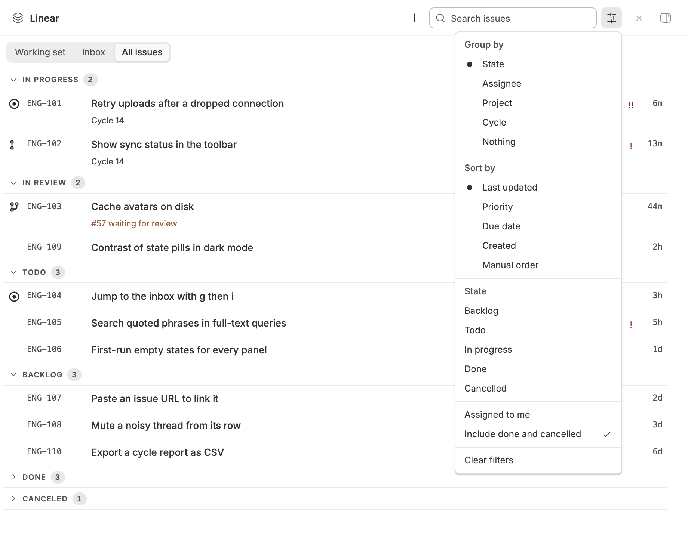
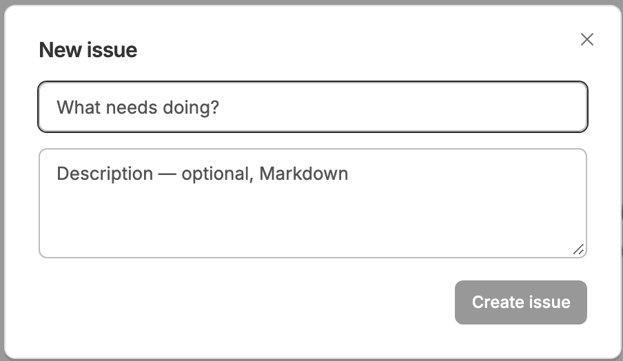
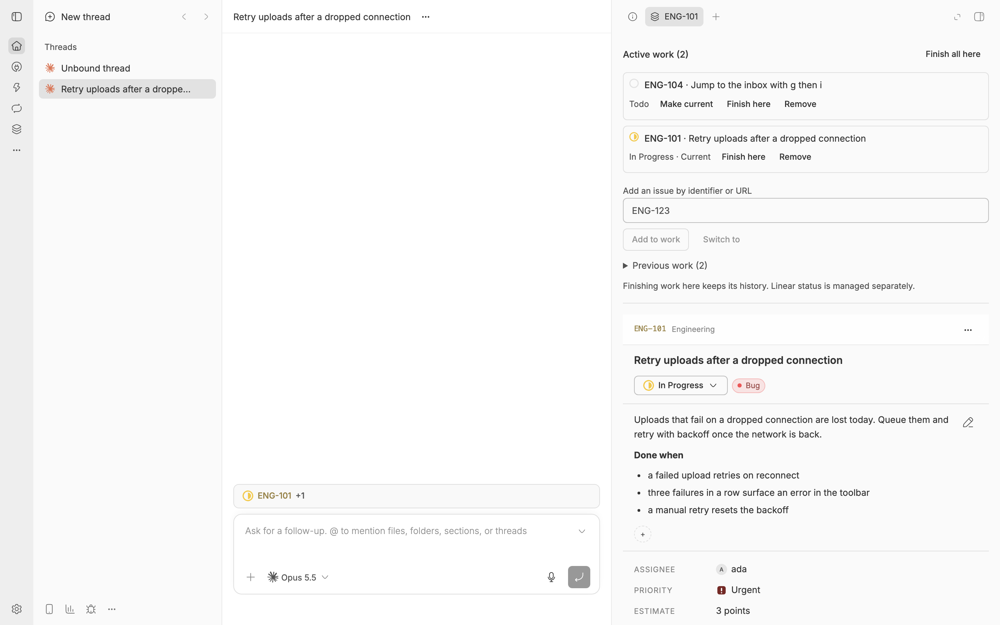
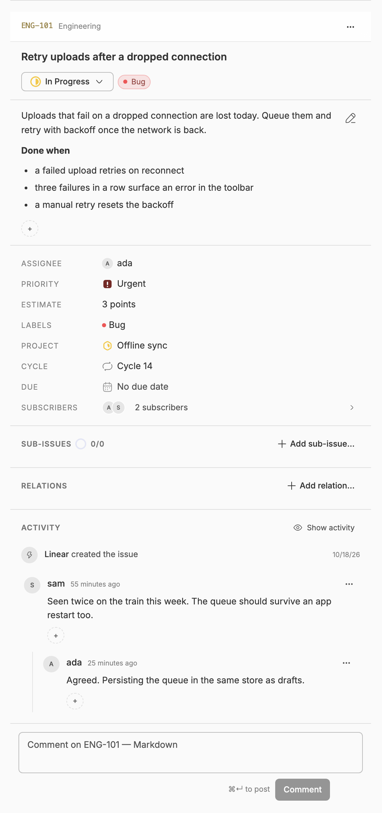
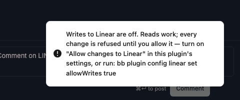
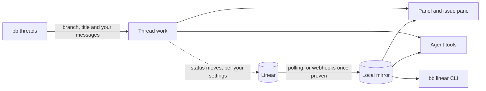

<h1 align="center">Linear for bb</h1>

<p align="center"><b>Your Linear issues, inbox, projects and cycles inside <a href="https://getbb.app">bb</a>, at parity for daily engineering work,<br>and every thread knowing, live, which issue it is working on.</b></p>

<p align="center">
<a href="https://github.com/vburojevic/bb-plugin-linear/releases/latest"></a>
<a href="https://getbb.app"></a>
<a href="LICENSE"></a>
<a href="https://github.com/get-bb/marketplace"></a>
</p>

<picture>
  <source media="(prefers-color-scheme: dark)" srcset="assets/readme/hero-dark.svg">
  
</picture>

## Install

It is listed in the [BB Community marketplace](https://github.com/get-bb/marketplace), so bb installs it by name:

```sh
bb plugin install linear
```

Or straight from this repository:

```sh
bb plugin install git:https://github.com/vburojevic/bb-plugin-linear.git@main
```

> [!NOTE]
> Installing needs `git` and `npm` on your PATH. bb clones the repository, installs the runtime dependencies, and builds the frontend on your machine. Nothing pre-built ships in the repo, so what runs is what you can read.

Then create a personal API key in Linear under **Settings → Account → Security & access → Personal API keys**, and connect it:

```sh
bb plugin config linear set apiKey <key>
bb linear teams
bb linear bind ENG
```

> [!TIP]
> A read key is enough to browse. Use a key with write access when you want to change issues from bb.

## Highlights

<table>
<tr>
<td width="50%" valign="top">

**A local mirror**<br>
Every read answers from SQLite on your machine: instant, offline-tolerant and free of rate limits.

</td>
<td width="50%" valign="top">

**Threads know their issue**<br>
The current issue sits above the composer, in the side panel, and in the agent's own context.

</td>
</tr>
<tr>
<td width="50%" valign="top">

**A Working set**<br>
What your threads, branches and pull requests are doing right now, and what is waiting for you.

</td>
<td width="50%" valign="top">

**The whole issue, in place**<br>
Properties, sub-issues, relations, resources and Linear's activity timeline, with real editors.

</td>
</tr>
<tr>
<td width="50%" valign="top">

**Up to 19 agent tools**<br>
The same `linear_*` tools in Claude, Codex, Kimi, OpenCode and Gemini threads, over one credential.

</td>
<td width="50%" valign="top">

**One switch for every write**<br>
Turn off "Allow changes to Linear" and every change is refused while every read keeps working.

</td>
</tr>
</table>

## The browser

<picture>
  <source media="(prefers-color-scheme: dark)" srcset="assets/readme/panel-dark.png">
  
</picture>

The left nav panel is a list-first Linear browser at sidebar width, rendered from a **local SQLite mirror**, so every read is instant, offline-tolerant, and free. Your team's board becomes collapsible state groups. Finished work starts folded behind a count, and open work gets the screen. Priorities mark only what deserves a mark: `!!` urgent, `!` high, nothing for the rest. When the list is grouped by state, the lead column shows what bb knows about each issue instead: a running thread, a branch, or a pull request.

## The Working set

<picture>
  <source media="(prefers-color-scheme: dark)" srcset="assets/readme/working-set-dark.png">
  
</picture>

The default segment answers questions the Linear tab in your browser cannot, because only bb knows about threads, worktrees and pull requests. Its buckets are ordered by what you would do next: **Running**, **PR needs you**, **In progress, no PR**, **Blocked**, and **Assigned to you, never started**. Each issue lands in at most one of them.

## Search

<picture>
  <source media="(prefers-color-scheme: dark)" srcset="assets/readme/search-dark.png">
  
</picture>

Full-text search over the mirror, answering as you type. A miss says how many issues the cleared view holds, and the button under it clears the filters, so the sentence and the control agree.

## Group, sort, filter

<picture>
  <source media="(prefers-color-scheme: dark)" srcset="assets/readme/filters-dark.png">
  
</picture>

Group by state, assignee, project or cycle. Sort by activity, priority, due date, age, or Linear's own manual order. The filter facets are **derived from your team's actual workflow**: a triage-enabled team gets a Triage chip, and a team without one never sees it.

## Capture

<p align="center">
<picture>
  <source media="(prefers-color-scheme: dark)" srcset="assets/readme/create-dark.png">
  
</picture>
</p>

The `+` in the panel's header files an issue with the two fields you have at the moment of capture: a title, and maybe a description. It lands directly in the new issue's detail pane, where everything else has a real editor. A create form with nine fields loses the race against a sticky note.

## The thread chip

<picture>
  <source media="(prefers-color-scheme: dark)" srcset="assets/readme/thread-dark.png">
  
</picture>

A thread tracks **active issues**, one **current issue**, and **previous work**. The context row above the composer shows the current issue and a count of additional active issues, for example `ENG-42 +2`, and stays hidden when a thread has nothing to show. Click it to open the issue tab, where you can focus, finish, remove, or resume work without losing its history. Opening an issue's detail does not change what the thread is working on.

Agents record task acceptance and transitions through `linear_thread_work`, including moving to the next queued task. New accepted user messages are scanned incrementally. Incidental references become suggestions with separate **Switch to** and **Add to current work** actions. Initial branch and identifier binding still works, but old branches and prompts cannot resurrect work after an explicit switch, finish, or removal. Assistant and tool output never bind.

`start` switches the active set to one issue and preserves previous work. `add` keeps concurrent tasks. `focus` changes the current issue. `finish` ends work on one issue here. `remove` dismisses a mistaken link. `clear` ends all active work here. These operations change bb only. Linear workflow status is managed separately for the particular issue.

```sh
bb linear work                         # current, active, previous, revision
bb linear work start ENG-42
bb linear work add ENG-43
bb linear work focus ENG-43 --revision 2
bb linear work finish ENG-43
```

<details>
<summary>For other plugins: reading a thread's issues</summary>

The existing `linear_thread_bind` and `bb linear link` shortcuts still set one current issue. RPC `threadIssue` and batch `threadIssues` keep `binding` as the current-issue projection and add `active` and `activeCount`. `threadIssue` also returns `history`, `historyCount`, and `revision`.

Batch reads stay mirror-only and are capped at 200 threads, with at most 20 active issues per thread. The panel shows the latest 50 available history entries; older issues stay stored and can be resumed by identifier. Sidebar consumers can use `activeCount` to show additional work while older clients follow `binding`.

</details>

## The issue pane

<p align="center">
<picture>
  <source media="(prefers-color-scheme: dark)" srcset="assets/readme/detail-dark.png">
  
</picture>
</p>

The bound issue, or any issue you open, the way Linear shows it:

- the parent it belongs to, and a description and title you edit in place
- properties with in-place editors: state, assignee, priority, estimate, labels, project, cycle, due date
- subscribers, sub-issues with Linear's progress ring, and relations in every direction
- resources grouped by source (pull requests, documents, links) and customer requests
- an **activity timeline**: history events and comments in one chronological feed, in Linear's own phrasing, with nested replies, resolved threads, reactions, an unread divider, a show-activity toggle and "show older" paging

Screenshots pasted into Linear render too, through a proxy pinned to Linear's upload host; every other remote image stays a link. From the pane you can react, edit or delete your own comments, @mention teammates, add a link, set a parent or add a sub-issue, and add or remove relations. The `···` menu starts a thread from the issue, copies its identifier or branch name, or archives it behind a confirmation.

## The inbox


Your Linear inbox as a segment with a badge: assignments, replies, mentions and blockers, dismissible row by row. A toast fires only when something *new* arrives, never for what was already waiting when you looked.

## The consent switch

<p align="center">

</p>

Turn off "Allow changes to Linear" and every mutation (edits, comments, creations, webhook registration) is refused with a sentence naming the switch, while every read keeps working. It is enforced at the one transport door every mutation leaves through, so a surface added later is gated the day it is written.

## Agents get the real thing

Up to nineteen `linear_*` tools over one credential, identical in Claude, Codex, Kimi, OpenCode and Gemini threads, in any project bound to a Linear team. They read the team's own vocabulary (states, labels, people, estimate scale, never guessed), search locally and escalate to Linear on request, and read and write in consolidated calls. They also include the tools no remote integration can have: this thread's **own work**, readable and writable. A bundled skill teaches the conventions.

<details>
<summary>The agent tools</summary>

| Tools | Available at |
| --- | --- |
| `linear_team_context`, `linear_search`, `linear_view_run`, `linear_issue_get`, `linear_issue_list`, `linear_project_list`, `linear_cycle_get` | Every setting |
| `linear_thread_issue`, `linear_thread_work`, `linear_thread_bind` (these read and change bb's record of the thread's work, never Linear) | Every setting |
| `linear_comment` | Comment and Full |
| `linear_comment_react`, `linear_comment_edit`, `linear_issue_update`, `linear_issue_create`, `linear_issue_set_parent`, `linear_issue_relate`, `linear_issue_attach`, `linear_thread_start` | Full |

"What agents may change in Linear" picks the setting: **Off** (10 tools), **Comment**, the default (11), or **Full** (all 19). Agents never get delete, archive or workspace administration at any setting.

</details>

## How it fits together



Reads come from the mirror. Writes go to Linear through one gated door and land back in the mirror.

## Everything else

- **Keyboard-first**: <kbd>j</kbd> / <kbd>k</kbd> move, <kbd>Enter</kbd> opens, <kbd>/</kbd> finds, <kbd>g</kbd> <kbd>i</kbd> and <kbd>g</kbd> <kbd>a</kbd> switch segments. Folded groups are skipped, never walked through.
- **Start a thread from any issue**: the row menu, the detail `···` menu, or `bb linear start ENG-42`. The thread spawns with the issue's description and recent comments as context, on the right project, with Linear's own branch name, bound from its first paint.
- **Issues in chat**: `::linear{key="ENG-42"}` renders as a live issue chip in any message, and "Open in Linear" on a message resolves every identifier it names.
- **Up to four workspaces**: each discovered from its own API key. Nothing is configured by hand, and cross-workspace ambiguity is refused by name rather than resolved by luck.
- **Write-back automations, off by default**: a bound thread starting can lift the issue into the team's started state, and a merged PR can move it per the team's own Linear git automation. They are off because two writers fighting over one card is worse than either alone. Starting a thread *from* an issue does move it to started by default, because you asked for that work.
- **Linear's own status icons**: the same ring, the same inner pie that grows with a state's position among the started states, the same disc with a check or an X, in each state's configured color. Parent issues carry Linear's sub-issue progress ring.
- **Binds itself only on explicit evidence**: an issue key in a branch or thread title that names exactly one visible team binds the project to it, announced with an undo. Anything fuzzier becomes an offer in the panel, never a bind.
- **Remote edits arrive hot**: a change made on linear.app promotes polling to seconds while somebody is watching, and a webhook delivery or local write wakes the poller instead of waiting out its sleep.
- **Webhooks as an upgrade, not a dependency**: registered only after a signed self-test proves the URL reaches this bb. Delivery is health-checked, and demotion back to polling is a log line, not an outage.
- **Budgeted**: Linear's rate-limit headers are read on every response. Background polling slows itself under pressure, and a person's click goes to the front of the queue.
- **Verified offline**: every GraphQL document ships as inspectable text, validated against the vendored SDL by the test suite. Complexity is estimated per document and capped below Linear's ceiling.
- **Secrets stay secrets**: keys live in bb's secret store, and every error, log line, tool result and RPC payload is redacted at construction.
- **Nothing hardcoded**: no team, state name, label scheme or estimate scale appears in this code. Everything is discovered from the workspace at runtime, in the workspace's own language.

## Reference

<details>
<summary>The CLI</summary>

```
bb linear status | doctor | budget        connection, diagnosis, rate budget
bb linear teams | bind | unbind | refresh teams and project bindings
bb linear issues | issue | create | sync  the mirror, read and written
bb linear move | assign | set | comment   one issue, changed
bb linear attach | archive                links; reversible archive
bb linear inbox | webhook | forget        inbox; webhooks; leave no trace
bb linear start | link | unlink | work    threads, current and concurrent work
```

Every read answers from the local copy. Run any read with `--json` for machine output. Commands that need a bb project use the one you run them from, or `--project <id>`. `set` uses `--project` for the Linear project to move the issue into, so it takes `--bb-project <id>` for the bb project.

</details>

<details>
<summary>Settings</summary>

| Setting | Default | What it does |
| --- | --- | --- |
| Linear API key | | Your personal API key. Up to three more keys connect other workspaces. |
| Allow changes to Linear | On | Off makes the plugin read-only: every change is refused, every read keeps working. |
| What agents may change in Linear | Comment | Off, Comment, or Full. See the agent tools above. |
| Sync cadence | Balanced | Balanced polls a running thread's issue every 10 seconds and idles down to 10 minutes. Responsive halves every interval, Frugal doubles them. |
| Webhook URL | | A public HTTPS URL that reaches this bb. Empty means polling, which always works. Creating a webhook needs a Linear workspace admin, and a bb connect share link will not work. |
| Branch naming | Title | Title puts the identifier at the front of the thread title. Exact checks out Linear's branch name when it already exists and the tree is clean. |
| Bind projects to teams automatically | On | Binds a bb project when an issue key names exactly one team, announced with an undo. |
| Move the issue when a thread starts | On | Starting a thread from an issue moves it into the team's started state. |
| Move the issue when a bound thread starts working | Off | Lifts a bound issue forward into the started state, never backwards. |
| Move the issue when its pull request moves | Off | Follows the git automation your team configured in Linear. |
| Comment on the issue when a thread starts | Off | Posts a comment on the issue saying a bb thread has started. |
| Include sub-teams | Off | Also pulls the issues of a bound team's sub-teams. |
| Tell me when an issue is assigned to me | On | Notifies you in bb. |
| Tell me about comments, replies and mentions | On | Notifies you in bb. |
| Tell me when one of my issues is blocked | On | Notifies you in bb. |
| Push plugin | | Sends notifications through a push plugin that implements `docs/push-contract.md`. |
| OAuth client ID and secret | | Only for an organization with its own private Linear OAuth application. |

</details>

<details>
<summary>Troubleshooting</summary>

- `bb linear doctor` checks every precondition and names what is missing: the API key, the connection, team bindings, whether writes are allowed, and the request budget.
- `bb linear status` shows which workspaces this bb is connected to, and `bb linear budget` shows the rate budget left.
- After changing a key, run `bb linear refresh` to read the workspace again.
- `bb linear forget --yes` deletes the local copy of your workspace from this machine.

</details>

## Philosophy

What bb already owns (threads, environments, worktrees, branch names, git state, PR status, the Markdown renderer, the composer, the toaster, the settings form, the credential store), this plugin reads and never rebuilds.

It talks to Linear over the GraphQL API with its own credential rather than through Linear's MCP server. A background service cannot borrow an agent CLI's OAuth session, so it could not poll, notify, or move an issue when a pull request merges at 2am, and an MCP-only integration is invisible to every other provider bb runs. Where your agents *do* have Linear MCP, the write-back automations stay off by default so the two never fight.

Built in the open: the [BRIEF](./BRIEF.md) records every decision with the alternative it beat.

## License

MIT. See [LICENSE](LICENSE), and [NOTICE](NOTICE.md) for the Linear trademark notice.

<p align="center"><sub>More plugins for bb at <a href="https://github.com/vburojevic/bb-plugins">vburojevic/bb-plugins</a></sub></p>
